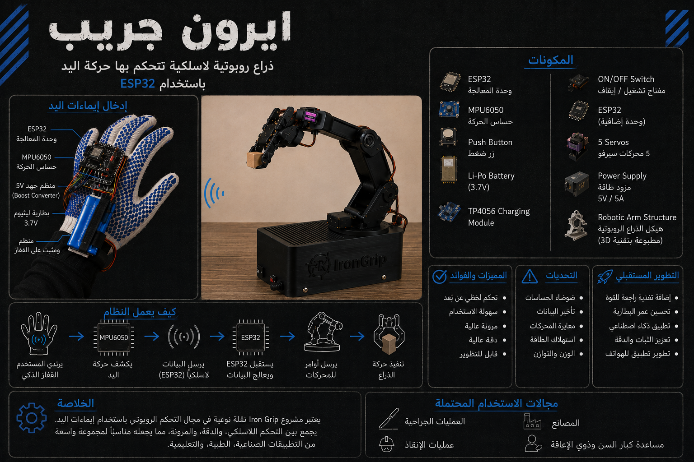

# IronGrip

**Wireless robotic-arm control using a smart glove** — a team project.

IronGrip (ايرون جريب) is a team project exploring how hand movements, captured by a sensor-equipped glove, can be transmitted wirelessly to control a robotic arm. The concept is built around the ESP32 microcontroller, an MPU6050 motion sensor, and servo motors.

> [!IMPORTANT]
> **This repository currently contains a project infographic only.**
> No firmware, circuit diagrams, CAD files, full documentation, or test evidence have been published yet. Nothing in this repository should be read as evidence that any feature has been implemented or tested.

## Project infographic



The infographic (in Arabic) is a **conceptual overview** of the project: the intended system flow, planned components, expected benefits and challenges, possible future improvements, and potential application areas.

It is an AI-assisted illustration — the image file carries embedded C2PA content credentials from OpenAI's image service. The glove and robotic arm shown in it are illustrative and should not be taken as photographs of the team's finished hardware.

### Concept at a glance

As described in the infographic, the intended system flow is:

1. The user wears the smart glove.
2. An MPU6050 motion sensor on the glove detects hand movement.
3. An ESP32 on the glove sends the motion data wirelessly.
4. A second ESP32 at the arm receives and processes the data.
5. The receiving ESP32 sends commands to the servo motors.
6. The robotic arm moves accordingly.

The components listed in the infographic include: two ESP32 boards, an MPU6050 motion sensor, a push button, a 3.7 V Li-Po battery, a TP4056 charging module, a 5 V boost converter, an on/off switch, five servo motors, a 5 V / 5 A power supply, and a 3D-printed robotic-arm structure.

These are the planned components shown in the infographic; the final bill of materials, wiring, and wireless protocol will be documented once the project files are added.

## Repository contents

```text
irongrip/
├── README.md
└── docs/
    └── images/
        └── irongrip-infographic.png
```

## Not yet included

The following may be added later as the team provides them:

- Glove (transmitter) firmware
- Robotic-arm (receiver) firmware
- Circuit diagrams and wiring details
- CAD / 3D-printing files for the arm and enclosure
- Full project documentation
- Testing evidence and results

## Team

IronGrip is a team project. Team member details will be added once confirmed.
